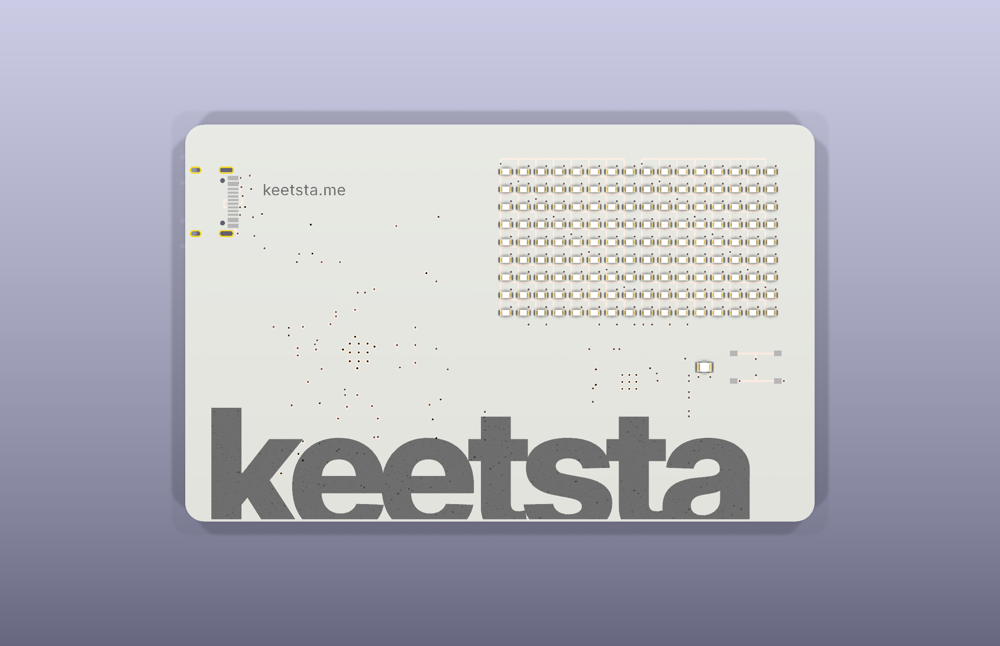
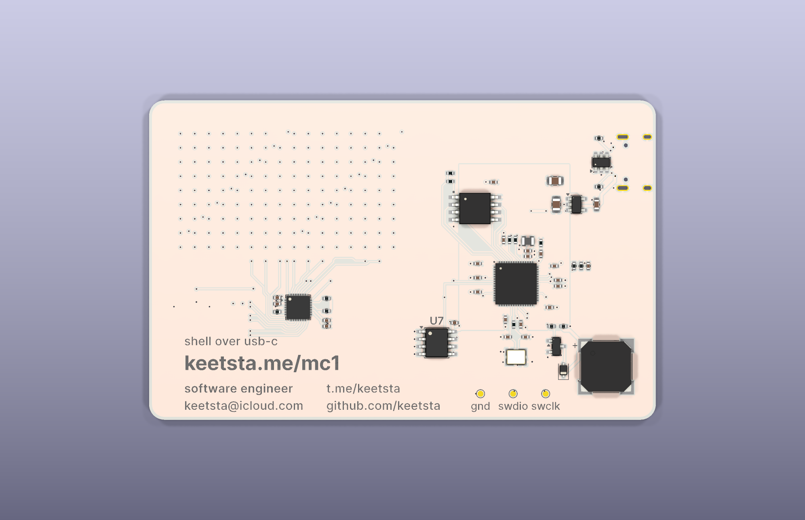

# mk1-card

hardware for mk-1, a pcb business card: an RP2350 with a 16 × 9 LED matrix, a light sensor, one button and USB-C. this repository holds the schematic, the board, the fabrication files and the scripts that generate them. the firmware lives in a separate repository.




## board

- 85.6 × 54 mm (bank card size), 4 layers, 1.0 mm, ENIG, white mask, black silkscreen
- RP2350A with the crystal and 16 MB flash of the Raspberry Pi minimal design R4. the core runs from a 1.1 V LDO instead of the on-chip switching regulator
- IS31FL3731 driving 144 red 0603 LEDs from VBUS
- TEMT6200 light sensor on ADC0 with a switchable load, AT24C02 EEPROM, USB-C with ESD protection, SWD pads on the back
- one button, wired as BOOTSEL: hold it while plugging in the cable to get the UF2 drive
- every chip sits on the back, so assembly is double-sided

pins and parts: `tools/design.py`. BOM with prices (in Russian): `bom.md`.

## build

the KiCad files are generated: change `tools/design.py` or the scripts in `tools/`, never the board or the schematic by hand. the scripts expect Windows with KiCad 9 in `C:\Program Files\KiCad\9.0` and Python 3 with `fontTools` and `openpyxl`.

```
python tools/make_fplib.py
python tools/gen_sch.py
python tools/make_text.py "tools/fonts/InterTight[wght].ttf"
"C:\Program Files\KiCad\9.0\bin\python.exe" tools/build_pcb.py
python tools/make_fab.py
python tools/make_bom.py
```

`build_pcb.py` places, routes and pours the board in about a minute. the build is deterministic: the same input gives the same board byte for byte. ERC (`kicad-cli sch erc`) and DRC (`kicad-cli pcb drc --schematic-parity`) both report 0 errors.

## ordering

JLCPCB: upload `fab/card-gerbers.zip`, `fab/card-bom.csv` and `fab/card-cpl.csv`. parts go on both sides, which means Standard PCBA with 5 mm rails on the long edges: snap them off and sand the edge. turn on parts placement confirmation and check the LED cathodes, the light sensor and pin 1 of U1..U8 in the preview.

`fab/card-cpl.csv` is written in JLC's footprint orientations. any other assembler gets `fab/card-cpl-kicad.csv` and the assembly drawings `fab/card-assembly-top.pdf` and `fab/card-assembly-bottom.pdf`.

## license

MIT, see `LICENSE`. the RP2350 core is adapted from the Raspberry Pi RP2350A minimal design (MIT, `tools/ref/LICENSE-RPi-minimal.txt`). Inter Tight is under the SIL Open Font License (`tools/fonts/OFL-InterTight.txt`).
